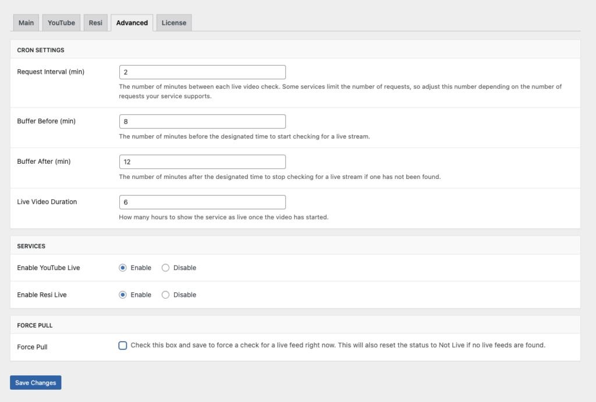

# Advanced Settings

The Advanced Settings page gives you control over how frequently CP Live checks for streams, how long to show a stream as live, and which streaming services are enabled.

## Accessing Advanced Settings

1. Log in to your WordPress admin dashboard
2. Navigate to **Settings → CP Live**
3. Click the **Advanced** tab

## Cron Settings

These settings control how CP Live checks for live streams.

| Setting | Default | Description |
| --- | --- | --- |
| **Request Interval (min)** | 2 | How often (in minutes) CP Live checks for a live stream. Lower values detect streams faster but use more API quota |
| **Buffer Before (min)** | 8 | How many minutes before the scheduled time to start checking for a live stream |
| **Buffer After (min)** | 12 | How many minutes after the scheduled time to keep checking if no stream has been found |
| **Live Video Duration** | 6 | How many hours to continue showing the stream as live after it is first detected |

### Understanding Buffers

Buffers create a window around your scheduled service time during which CP Live actively checks for streams. For example, with a 9:00 AM schedule, an 8-minute buffer before, and a 12-minute buffer after:

- Checking starts at **8:52 AM** (8 minutes before)
- If no stream is found by **9:12 AM** (12 minutes after), checking stops until the next scheduled time

Adjust these values based on how early or late your streams typically start.

## Services

Enable or disable each streaming service. Only enabled services appear as configuration tabs and are checked during scheduled times.

- **Enable YouTube Live**: Enabled by default. Turn off if you do not use YouTube for streaming.
- **Enable Resi Live**: Disabled by default. Enable if you use Resi as your streaming provider.

## Force Pull

Use Force Pull to manually trigger a live stream check outside of your regular schedule:

1. Check the **Force Pull** checkbox
2. Click **Save Changes**
3. CP Live immediately checks all active services for a live stream
4. If no live stream is found, the status resets to **Not Live**

This is useful for testing your configuration or troubleshooting detection issues.

## Troubleshooting

If your advanced settings are not behaving as expected:

- Ensure your request interval is not set too high, which could cause missed streams
- Verify that WordPress cron is running properly on your server
- Check the [Troubleshooting](../advanced/troubleshooting.md) guide for more help
