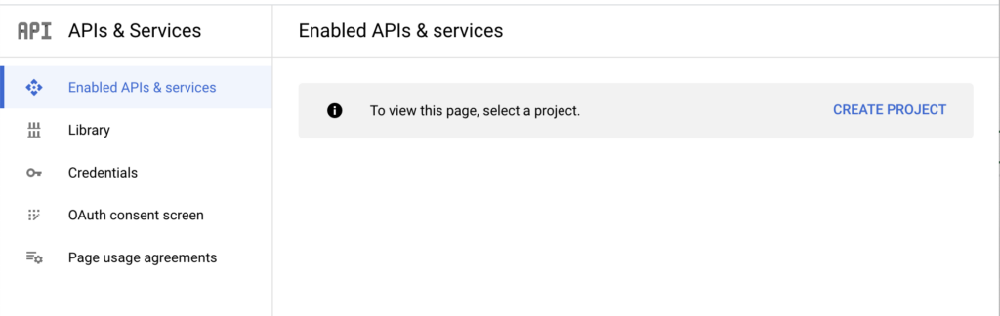
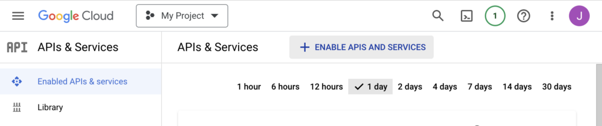
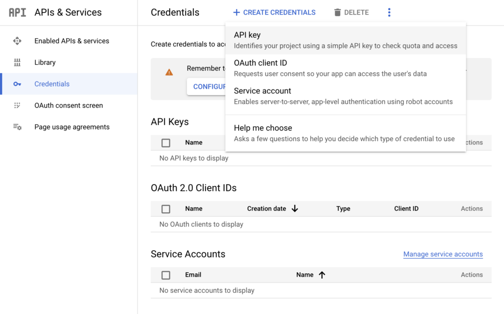
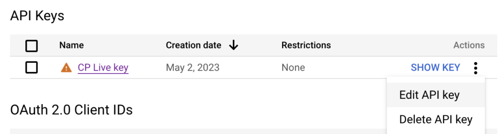
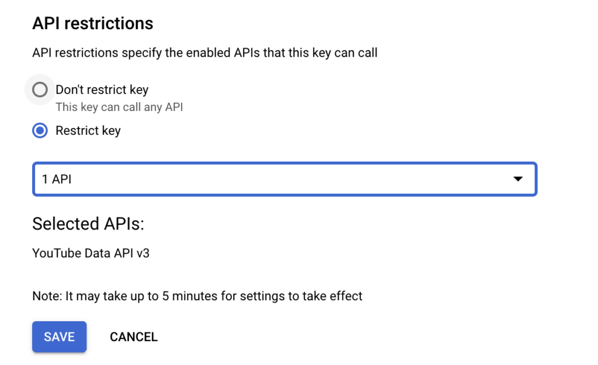
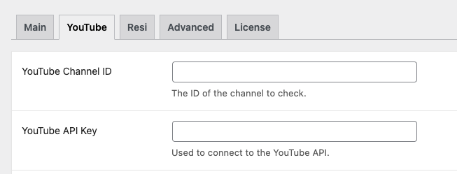
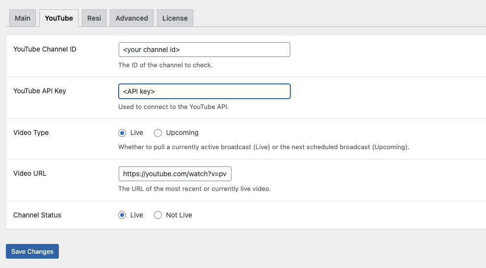

# Connecting to YouTube

CP Live integrates with the YouTube Data API to automatically detect live and upcoming broadcasts from your YouTube channel. This guide walks you through configuring YouTube as your streaming service.

## Prerequisites

Before configuring YouTube in CP Live:

- YouTube live streaming is enabled on your channel
- You have a YouTube Data API key from the [Google Cloud Console](https://console.cloud.google.com)
- You know your YouTube Channel ID

## Getting Your YouTube API Key

1. Go to the [Google Cloud Console](https://console.cloud.google.com)
2. Create a new project or select an existing one

3. Navigate to **APIs & Services → Library**
4. Search for **YouTube Data API v3** and enable it

5. Navigate to **APIs & Services → Credentials**
6. Click **Create Credentials → API Key**

7. Copy the generated API key

### Restricting Your API Key

For security, restrict your API key:

1. Click on the API key in the Credentials list

2. Under **API restrictions**, select **Restrict key**
3. Choose **YouTube Data API v3** from the list

4. Click **Save**

## Finding Your Channel ID

1. Go to your YouTube channel page
2. Click on your profile icon and select **Your channel**
3. Your Channel ID is in the URL: `https://www.youtube.com/channel/YOUR_CHANNEL_ID`

If your channel uses a custom URL, find your Channel ID in **YouTube Studio → Settings → Channel → Advanced settings**.

## Configuring YouTube in CP Live

1. Navigate to **Settings → CP Live**
2. Click the **YouTube** tab
3. Configure the following settings:

| Setting | Description |
| --- | --- |
| **YouTube Channel ID** | Your YouTube channel ID |
| **YouTube API Key** | Your YouTube Data API key |
| **Video Type** | Choose **Live** to detect currently streaming broadcasts, or **Upcoming** to detect the next scheduled broadcast |
| **Video URL** | Displays the URL of the most recent or currently live video (auto-populated) |
| **Show Subscribe Button** | Show or hide a YouTube subscribe button below the video embed |

4. Click **Save Changes**

## Testing Your Configuration

1. Navigate to **Settings → CP Live → Advanced**
2. Check the **Force Pull** checkbox
3. Click **Save Changes**
4. Return to the **YouTube** tab to verify the **Video URL** and **Channel Status** fields

## API Quota Considerations

The YouTube Data API has a daily quota limit (default: 10,000 units). Each live stream check uses approximately 100 units. With a 2-minute check interval and a 20-minute schedule window (8 min before + 12 min after), each service consumes roughly 1,000 units per schedule.

To minimize quota usage:

- Set the check interval appropriately in [Advanced Settings](advanced-settings.md)
- Adjust buffer times to match your typical stream start patterns
- Use the **Upcoming** video type if you schedule broadcasts in advance

## Troubleshooting

### Stream Not Detected

1. Verify your API key is valid and has YouTube Data API v3 enabled
2. Confirm your Channel ID is correct
3. Check that your scheduled time window covers when you go live
4. Use **Force Pull** to test detection outside of scheduled times

### Subscribe Button Not Appearing

1. Verify **Show Subscribe Button** is set to **Show**
2. Check that your Channel ID is entered correctly
3. Clear any page caches on your site

For more help, see the [Troubleshooting](../advanced/troubleshooting.md) guide.
