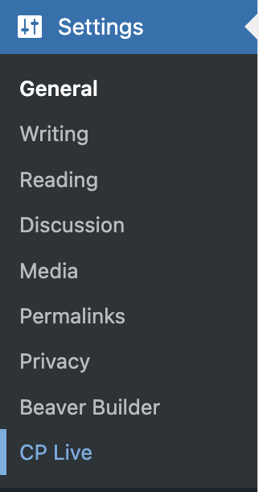
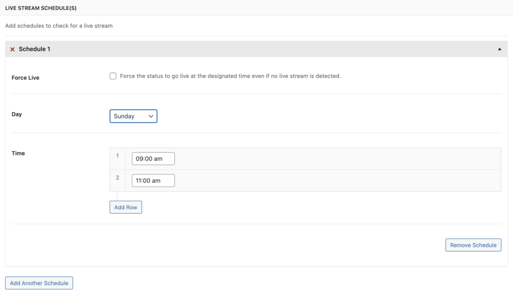

# Managing Livestreams

The General Settings page allows you to configure your live stream schedule and choose what displays when you are not live. This is the first place to set up after activating CP Live.

## Accessing General Settings

1. Log in to your WordPress admin dashboard
2. Navigate to **Settings → CP Live**

3. The **Main** tab is selected by default

## Display Options

### When Not Live

Choose what visitors see when no live stream is active:

- **Show most recent video**: Displays the last detected video embed from your streaming service
- **Show countdown to the next stream**: Displays a countdown timer to your next scheduled service time

## Live Stream Schedules

Schedules tell CP Live when to check for live streams. You can add multiple schedules to cover all your regular service times.

### Adding a Schedule

1. Click **Add Another Schedule** to create a new schedule entry
2. Configure the following fields:

| Field | Description |
| --- | --- |
| **Force Live** | When checked, automatically sets your site to "live" at the scheduled time, even if no stream is detected from your provider |
| **Day** | The day of the week for this schedule (Sunday through Saturday) |
| **Time** | The time your service starts. You can add multiple times per day by clicking the **+** button |

### Example Configuration

For a church with Sunday services at 9:00 AM and 11:00 AM, and a Wednesday evening service at 7:00 PM:

1. Create a schedule for **Sunday** with times **9:00 AM** and **11:00 AM**
2. Create a second schedule for **Wednesday** with time **7:00 PM**

### Removing a Schedule

Click **Remove Schedule** on any schedule entry to delete it.

## Applying Settings

1. Click **Save Changes** at the bottom of the page
2. The page refreshes with a confirmation message

## Troubleshooting

If your schedules are not working as expected:

- Verify your WordPress timezone is set correctly in **Settings → General**
- Check that WP-Cron is functioning on your hosting environment
- Adjust the buffer settings in [Advanced Settings](advanced-settings.md) if streams are being missed

For more help, see the [Troubleshooting](../advanced/troubleshooting.md) guide.
